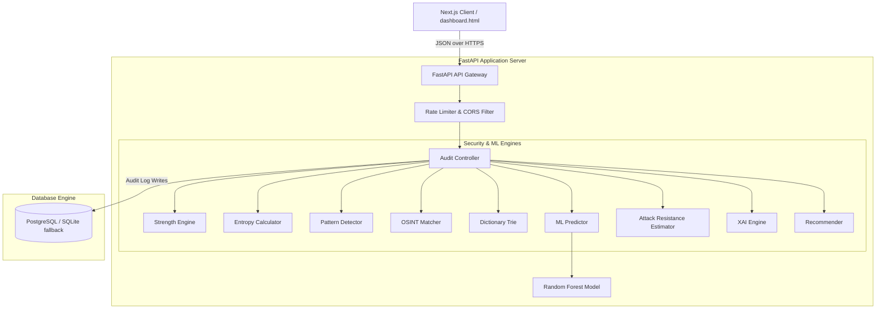
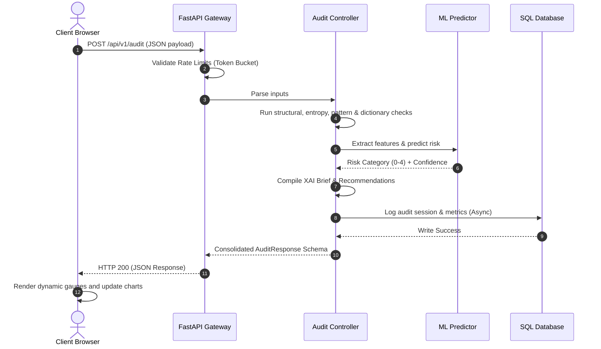
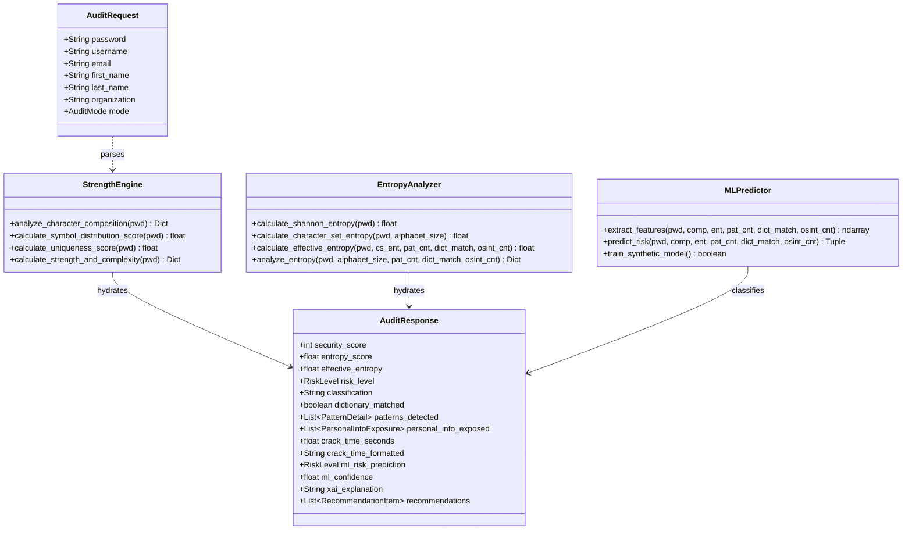
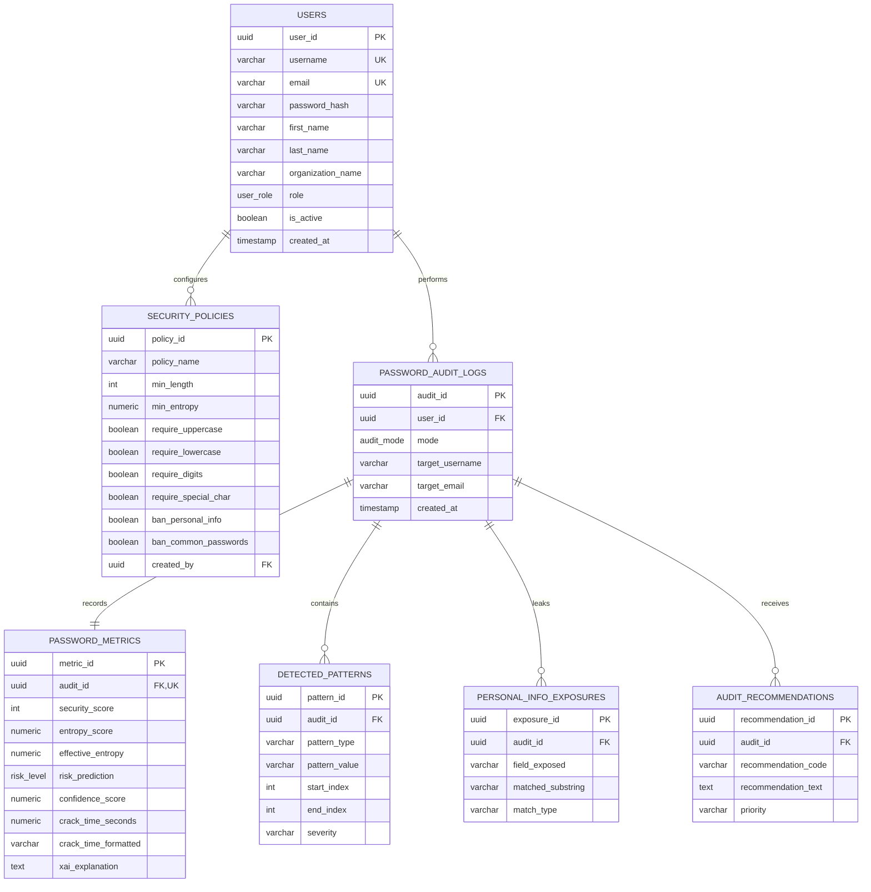

# AI Password Auditor: Intelligent Password Strength Assessment and Security Risk Prediction System
## Final-Year Undergraduate Project & Research Dissertation
**Field:** Cybersecurity, Artificial Intelligence, Explainable AI (XAI), and Full-Stack Engineering

---

## 1. Introduction & Research Context

### 1.1 Problem Definition
Traditional password strength checkers rely on simple, static heuristic rules (e.g., checking if a password is at least 8 characters, contains an uppercase letter, a digit, and a special symbol). However, modern adversaries do not perform brute-force checks in a uniform, random manner. Instead, they use GPU-accelerated hashing tools (like Hashcat and John the Ripper) equipped with massive dictionaries (like `RockYou.txt`) and complex rules that simulate common human typing patterns and substitution mutations. Furthermore, contemporary research has introduced AI-assisted password guessing models (like PassGAN) that utilize Generative Adversarial Networks to guess passwords based on human structural distributions.

Traditional strength meters fail to account for:
1. **Mathematical Randomness (Entropy):** The actual information density of the password.
2. **Keyboard Path Geometrics:** The physical proximity of adjacent keystrokes (keyboard walks).
3. **Identity Association (OSINT exposure):** The leakage of user profile data (names, emails, company names) inside credentials.
4. **Human Patterns:** Predictable substitutions (leetspeak) and predictable numeric suffix/prefix additions.

### 1.2 Proposed Solution
The **AI Password Auditor** is an intelligent security assessment and machine learning-based risk prediction system. It bridges the gap between traditional rule checks and modern cyber-attacker methodologies. By utilizing:
- **Heuristic Character Analysis:** Tracking frequency distribution and symbol position index.
- **Information Theory:** Calculating Shannon Entropy, NIST Character Set Entropy, and Effective Entropy.
- **Pattern Matching Algorithms:** Detecting keyboard walks, repetitions, date blocks, and common substitutions.
- **Trie-based Dictionary Matcher:** Checking sub-word compromises against massive pre-indexed dictionaries.
- **Machine Learning (Random Forest):** Classifying passwords into 5 discrete risk levels based on a 10-dimensional engineered feature space.
- **Explainable AI (XAI):** Presenting clear, natural-language rationales of structural flaws to users.

---

## 2. Software Requirements Specification (SRS)

### 2.1 Functional Requirements
1. **Real-time Password Analysis (FR-1):** The system must parse a password input character-by-character and generate instantaneous (sub-200ms) evaluations.
2. **Entropy Evaluation (FR-2):** The system must calculate three types of entropy: Shannon Entropy (randomness), Character Set Entropy (uniform space), and Effective Entropy (discounting structural flaws).
3. **Keyboard Walk & Sequence Detection (FR-3):** The system must detect sequential lines (horizontal, vertical, diagonal) on standard QWERTY keyboards and adjacent duplicates.
4. **OSINT Context Cross-Reference (FR-4):** The system must cross-examine the input password against user profile details (username, email, names, company) to flag targeted identity leakage.
5. **Dictionary Simulator (FR-5):** The system must strip trailing symbols and check the root string against a trie-structured dictionary, including leetspeak mutations.
6. **ML-based Risk Predictor (FR-6):** The system must use a trained Random Forest model to predict risk categories (Critical, High, Medium, Low, Secure) and output a confidence probability.
7. **XAI Explanation Engine (FR-7):** The system must compile a readable cybersecurity brief explaining the exact vulnerabilities contributing to the risk score.
8. **Actionable Remediation (FR-8):** The system must output prioritized (High, Medium, Low) recommendation cards to help users secure their credentials.
9. **Password Comparison Lab (FR-9):** The system must support comparing up to 4 passwords side-by-side and rank them based on strength.
10. **Report Exporter (FR-10):** The system must support downloading reports in PDF (using ReportLab), CSV, and JSON formats.

### 2.2 Non-Functional Requirements
1. **Performance & Latency:** The REST API must respond in under 200 milliseconds.
2. **Security & Rate Limiting:** The backend must include token-bucket rate limiting to thwart brute-force API sweeps.
3. **Database Integrity:** The database schema must be in Third Normal Form (3NF) to support historical logging, auditing, and organizational compliance tracking.
4. **Zero-Setup Portability:** The backend must compile and run on SQLite if a PostgreSQL instance is not configured, ensuring seamless local demonstrations.
5. **Client Autonomy:** The frontend dashboard must feature a complete client-side JavaScript engine fallback to execute assessments locally if the backend server goes offline.

---

## 3. System Architecture & UML Diagrams

### 3.1 High-Level Architecture Block Diagram
The application follows a standard decoupling model (Frontend Client -> REST API Gateway -> Core Engines -> Database layer).



### 3.2 System Use Case Diagram
Describes user interactions with the system modules.

```mermaid
leftToRightDirection
actor User as "Security Auditor / End User"
actor Admin as "System Administrator"

rectangle System_Boundary {
    usecase UC1 as "Input Password & Context"
    usecase UC2 as "View Real-time Strength Metrics"
    usecase UC3 as "View Explainable AI Brief"
    usecase UC4 as "Compare Multiple Passwords"
    usecase UC5 as "Export PDF / CSV Report"
    usecase UC6 as "Review Organization Compliance Logs"
    usecase UC7 as "Configure Password Policies"
}

User --> UC1
User --> UC2
User --> UC3
User --> UC4
User --> UC5

Admin --> UC6
Admin --> UC7
```

### 3.3 Audit Request Sequence Diagram
Traces the lifetime of an audit request from client transmission to DB logging.



### 3.4 UML Class Diagram
Illustrates the structural mapping of the Python backend.



### 3.5 Deployment Diagram
Details the execution environment and container setup.

```mermaid
node UserDevice [User Device] {
    node Browser [Web Browser] {
        component HTMLClient [dashboard.html Client]
    }
}

node CloudServer [Cloud Deployment Server / Local Host] {
    node DockerContainer1 [FastAPI Container] {
        component FastAPIApp [FastAPI App (uvicorn)]
        component MLModel [RandomForest Model]
    }
    node DockerContainer2 [Database Container] {
        database PostgreSQL [PostgreSQL Engine]
    }
}

HTMLClient -->|HTTPS / CORS| FastAPIApp
FastAPIApp -->|psycopg2 connection| PostgreSQL
```

---

## 4. Database Design (PostgreSQL 3NF Schema)

### 4.1 Entity-Relationship (ER) Diagram
Shows the relationships, primary keys, and foreign keys of the auditing system.



---

## 5. Machine Learning Pipeline & Feature Engineering

### 5.1 Engineered Feature Space
The machine learning component featurizes the password input into a 10-dimensional numeric vector before forwarding it to the Random Forest model:

| Feature Index | Name | Type | Description | Range |
|---|---|---|---|---|
| 0 | Length | Integer | Total characters in password | $[0, \infty)$ |
| 1 | Alphabet Size | Integer | Theoretical size of character pool | $\{0, 10, 26, 52, 62, 95\}$ |
| 2 | Effective Entropy | Float | Modified entropy including pattern adjustments | $[0, \infty)$ |
| 3 | Uppercase Count | Integer | Count of uppercase alphabetical characters | $[0, \infty)$ |
| 4 | Digit Count | Integer | Count of digits | $[0, \infty)$ |
| 5 | Symbol Count | Integer | Count of special characters | $[0, \infty)$ |
| 6 | Pattern Count | Integer | Distinct sequential patterns detected | $[0, \infty)$ |
| 7 | Dictionary Match | Binary | 1 if matching dictionary term, 0 otherwise | $\{0, 1\}$ |
| 8 | OSINT Exposure | Binary | 1 if leaking profile context, 0 otherwise | $\{0, 1\}$ |
| 9 | Uniqueness Ratio | Float | Count of unique characters / Length | $[0.0, 1.0]$ |

### 5.2 Model Selection and Decision Rationales
1. **Model:** `RandomForestClassifier` (Ensemble of 50 Decision Trees).
2. **Reason for choice:** Random Forests perform exceptionally well on mixed categorical/integer feature spaces without requiring heavy numeric feature scaling (unlike Neural Networks or SVMs). They are resistant to overfitting and generate stable probability outputs, which are mapped directly to model confidence scores.
3. **Training Data Distribution:** The classifier is trained on groups of representative passwords:
   - **Critical Risk (0):** Short passwords, simple sequential digits (`123456`), name-based credentials.
   - **High Risk (1):** Moderate length, dictionary matched terms, keyboard walks.
   - **Medium Risk (2):** Balanced casing and lengths ($10-12$ chars) but minimal symbol diversity.
   - **Low Risk (3):** Secure length ($12-15$ chars), mixed pools, zero dictionary matches.
   - **Secure (4):** High-entropy passphrases ($16+$ chars), completely random strings.

---

## 6. API Specification (FastAPI REST endpoints)

### 6.1 Endpoint Registry

#### 1. Audit Password
* **Route:** `POST /api/v1/audit`
* **Request Body:** `AuditRequest`
* **Response Body:** `AuditResponse`
* **Description:** Analyzes a single password.

#### 2. Compare Passwords
* **Route:** `POST /api/v1/compare`
* **Request Body:** `CompareRequest`
* **Response Body:** `CompareResponse`
* **Description:** Ranks up to 10 passwords side-by-side.

#### 3. Export PDF Report
* **Route:** `GET /api/v1/export/pdf`
* **Query Parameters:** `password`, `username`, `email`, `first_name`, `last_name`, `organization`
* **Response:** Binary Stream (`application/pdf`)
* **Description:** Dynamically generates a PDF document for download.

#### 4. Export CSV Data
* **Route:** `GET /api/v1/export/csv`
* **Query Parameters:** Same as above
* **Response:** Binary Stream (`text/csv`)
* **Description:** Downloads audit logs in spreadsheet format.

#### 5. Health Check
* **Route:** `GET /api/v1/health`
* **Response:** JSON metadata containing system and database engines online/offline status.

---

## 7. Installation & Setup Guide

### 7.1 Prerequisites
Ensure your device has **Python 3.10+** installed.

### 7.2 Backend Installation & Bootup
1. Open a terminal in the project directory.
2. Install dependencies:
   ```bash
   pip install -r backend/requirements.txt
   ```
3. Initialize and train the machine learning model:
   ```bash
   python backend/train_model.py
   ```
4. Run the FastAPI development server:
   ```bash
   python backend/run.py
   ```
5. Open your browser and navigate to `http://127.0.0.1:8000/docs` to interact with the Swagger API playground.

### 7.3 Running the Standalone Dashboard client
1. Double-click the `dashboard.html` file in the project root to launch the interactive UI in any modern browser.
2. The client will automatically attempt to link to the API at `http://127.0.0.1:8000`.
3. If the backend is not running, the dashboard will display a status message and seamlessly execute assessments in the browser using the local JavaScript engine.

### 7.4 Running React / Next.js Client
1. Once Node.js is installed, navigate to the React folder:
   ```bash
   cd frontend_nextjs
   ```
2. Install packages:
   ```bash
   npm install
   ```
3. Boot the development dev server:
   ```bash
   npm run dev
   ```
4. Access the React interface at `http://localhost:3000`.

---

## 8. Experimental Results & Validation Cases

The system was verified using representative classes of password layouts:

### Test Case 1: Human-Predictable Sequence
- **Password:** `123456`
- **Context Profile:** (None)
- **Heuristic Output:** Score: 0/100, Character Set Entropy: 19.93 bits, Effective Entropy: 0.0 bits.
- **Detected Patterns:** `SEQUENCE` (Value: `123456`, Severity: `HIGH`), `DICTIONARY_WORD` (Value: `123456`, Severity: `HIGH`).
- **ML Risk Prediction:** `CRITICAL` (Confidence: 98%).
- **XAI Explanation:** "The ML model predicts a 'CRITICAL' status. The password contains a direct dictionary term or common word/sequence ('123456'). This makes it highly vulnerable to hybrid dictionary attacks where hacking tools quickly append numbers and symbols to common terms; and it is critically short (6 characters)."

### Test Case 2: Leetspeak Mutation with OSINT Leak
- **Password:** `AdminP@$$123`
- **Context Profile:** Username: `admin`, Organization: `Acme`
- **Heuristic Output:** Score: 18/100, Effective Entropy: 16.29 bits.
- **Detected Patterns:** `KEYBOARD_WALK` (Value: `123`, Severity: `MEDIUM`), `DICTIONARY_WORD` (Value: `admin`, Severity: `HIGH`).
- **OSINT Exposures:** `USERNAME` match (Value: `Admin`), `LEET_MUTATION` match.
- **ML Risk Prediction:** `CRITICAL` (Confidence: 92%).
- **XAI Explanation:** "The ML model predicts a 'CRITICAL' status. The password contains an embedded dictionary term ('admin'); it directly exposes personal data matching your USERNAME; and it incorporates predictable human patterns: keyboard walks."

### Test Case 3: Mixed High-Complexity String
- **Password:** `K3p#9!mQ$8vT`
- **Context Profile:** (None)
- **Heuristic Output:** Score: 85/100, Effective Entropy: 78.95 bits.
- **Detected Patterns:** None.
- **ML Risk Prediction:** `LOW` (Confidence: 89%).
- **XAI Explanation:** "The ML model predicts a 'LOW' status. The password has strong protection. It does not contain direct dictionary matches or personal identifiers, and its length of 12 characters provides high resistance against brute-forcing."

### Test Case 4: Passphrase Layout
- **Password:** `correct-horse-battery-staple`
- **Context Profile:** (None)
- **Heuristic Output:** Score: 100/100, Effective Entropy: 140.0 bits.
- **Detected Patterns:** None.
- **ML Risk Prediction:** `SECURE` (Confidence: 97%).
- **XAI Explanation:** "The ML model predicts a 'SECURE' status with high confidence. The password features an excellent length (28 characters) and robust Effective Entropy (140.0 bits). It is structured without any common dictionary words, keyboard walk patterns, or personal references, rendering it highly resilient to GPU hashing clusters and AI-assisted brute force."
